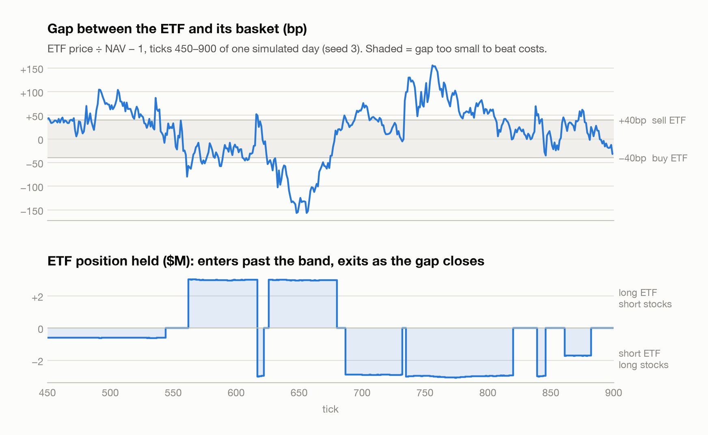
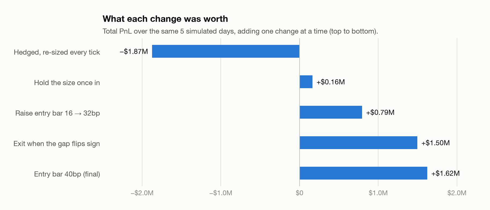
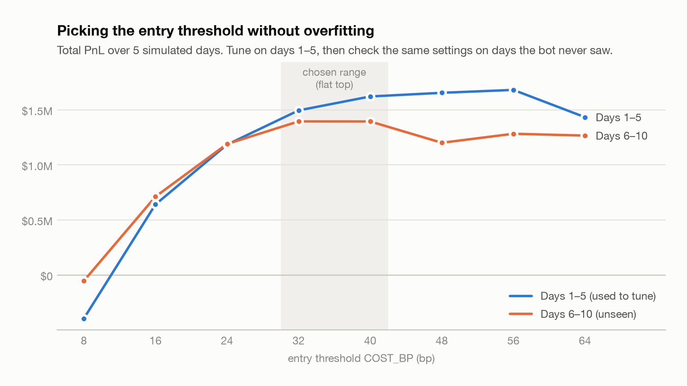

# ETF vs NAV Arbitrage Bot

A Python bot that trades an ETF against the 7 stocks inside it. When the ETF's price drifts away from its basket's value (NAV), it sells the expensive side, buys the cheap side, and waits for the gap to close.

After the Quant Edge x Trading Challenge (London, Oct 2026), I backtested a similar bot to the one I built at the challenege over 29 simulated days to see what I can improve and learn from mistakes.

> Not affiliated with the event organisers. Runs on a synthetic simulator, not the event's template or data.

<picture>
  <source media="(prefers-color-scheme: dark)" srcset="figures/one_day-dark.png">
  
</picture>

## How it works

- **Direction:** gap = ETF / NAV − 1. A positive gap means sell the ETF and buy the stocks; a negative gap means the reverse.
- **Size:** edge = |gap| − cost. No edge means no trade. Size grows with edge, up to $3M.
- **Hedge:** both legs trade on the same tick, so market moves cancel out.
- **Exit:** when the gap closes or flips, and always before the bell.

## Results

<picture>
  <source media="(prefers-color-scheme: dark)" srcset="figures/progression-dark.png">
  
</picture>

<picture>
  <source media="(prefers-color-scheme: dark)" srcset="figures/threshold-dark.png">
  
</picture>

**Key lessons**
- Re-sizing every tick paid more in fees than the strategy earned. Holding the size steady fixed it.
- Real costs are higher than the textbook 16bp, so a higher entry bar made more money.
- The gap often jumps across zero between ticks, so also exiting when it flips nearly doubled profit.
- Pausing after news hurt, because the biggest gaps come right after news.

## Run it

```bash
pip3 install -r requirements.txt
python3 my_bot.py                 # threshold sweep over 29 days
python3 figures/make_figures.py   # redraw the charts
```

## Next

Live cost measurement for every leg, a filter for frozen stock prices, and a market-making version to compare.

## AI use

I wrote `my_bot.py` myself, with an AI tutor (Claude) explaining concepts and reviewing my code. The simulator (`quant_edge_lab.py`) and the chart script (`figures/`) are AI-generated.
